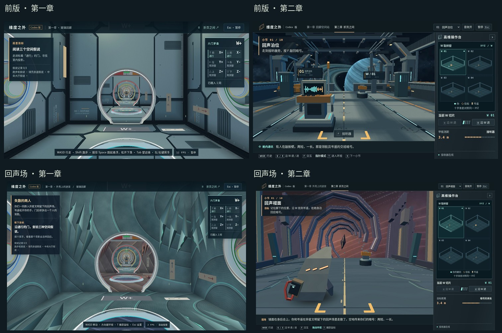

# 《维度之外》回声场版本游玩评估

从前版（`4431427`）和本版的同机位实机画面入手，评估对象是一名首次接触四维几何、会用 WASD 的玩家。这里最值得保留的是第一章的一个小动作：你朝门后那个人挥手，几道门外的手也同时抬起。玩家先产生一个问题，然后才有理由去查验空间的形状。[第一章试玩](https://zhang-guangfei.github.io/4d-space/codex/) · [第二章试玩](https://zhang-guangfei.github.io/4d-space/codex/chapter2/)

## 游玩中的阻力与改动

| 原版现场观察 | 对体验的影响 | 回声场版本的处理 |
| --- | --- | --- |
| 打开章节先看到开始页。部分小节到了现场，还需先按 F 接通装置 | 按完该按的键，玩家依然不知道自己在找谁 | 两章打开即可移动。每到新阶段，背景和当前目标自动出现；六小节移除了开场确认步骤。对白更新后，仍能在屏幕上找到背景 |
| 环视和点击仪表依赖同一个鼠标。仪表上的点只告诉玩家站在哪里 | 原地转身时，难判断自己面对哪个目标；玩家也容易错过可点击的控件 | 方向键在入场时就能环视。T 切换捕获与释放，第二章另有可点击的同名控件。高维操作台的玩家箭头随身体朝向转动。靠近可操作物体才出现现场 F 提示 |
| 第一章墙面重复出现面板、通风孔与铆接线。第二章开场的行星、吊架与维修台组成了熟悉的船坞 | 从一张开场图就能给整个世界定性，走到另一页也像走到另一间设施 | 第一章把 W/X/Y/Z 四族胞做成不同生长方向的矿质褶壁，门后也看得见相同纹理。第二章移去开场行星，远处折线与近处异物有不同视差。跨 W 时脚下位置不动，周围结构与人影改变 |
| 房间编号、取样和签收很清楚，任务之间的联系却很弱 | 解完某个机关后，缺少去下一处的理由 | 两人用登山绳和“两短一长”互认。取回一枚绳扣会绷紧下一节的断绳，接通断桥才看清远处的球；同一条线索在重逢之后仍有用 |

## 两个人到底在找什么

你和岑遥一起跌进某种文明建造的场。手里的地球图册还在，但其中的断臂雕像已经出现在玻璃后。你们走散后，彼此仍能用两短一长的敲击辨认。剧本只给出两人亲自验证过的事实。观察到场会保留相遇的位置，并不足以推断建造者的身份和目的。

第一章分三段。先在玻璃回廊看背影、挥手、查验三种假说；回到原点解开六向门，失重后用岑遥的暗号记录八个地点；最后尝试用一条连续且不重访的路线把她的声音接起来。六门罗盘和已访地图始终服务于找路，路线答案由玩家主动调出。第一章的谜底随调查解锁。

**下表含第二章情节与解法。**

| 小节 | 玩家进场看到或得知的事 | 此刻要做的事 |
| --- | --- | --- |
| 01 回声褶面 | 面前空无一人，暗号却近在咫尺 | 记住站位，沿 W 找到岑遥，回应她 |
| 02 无缝之壁 | 她丢的绳扣出现在没有开口的墙后，断口留着红线 | 绕过封壁，取回绳扣 |
| 03 折页天桥 | 两端断绳同时绷紧，她已在裂隙另一侧 | 转动折桥，对准两个接点，走过去收绳 |
| 04 潮汐球 | 同一颗球，在两人眼中差了两臂的宽度 | 先刻下一道球痕，越过最宽处，预测另一侧会在哪儿与旧痕重合 |
| 05 八面体雪线 | 六尖晶体和球在中心一样宽 | 到同一侧比较两条刻痕，看哪一件缩得更快 |
| 06 四维货栈 | 晶体露出缺口，岑遥钻进只能看见一页的引导车 | 切换 XYZ / XYW 观察基，指引她将金块推到 W4 接点 |
| 07 反手钥匙 | 缺口交还两半钥片，星点对得上，齿却像两只左手 | 让半片经过第四个方向翻转，回来与她的半片拼合 |
| 08 双环结 | 两只完整的环分别系着两个人 | 保持绳索完整，握住活动环，从相邻切片绕过固定环再扣回 |
| 09 第二脉搏 | 双环已经松开，岑遥胸前仍有一种更慢的节拍 | 帮她定位航服织带里的异物，换一页取出薄签 |
| 10 空白回执 | 薄签刻着两人碰到彼此的位置，却留着一个空端 | 送出薄签，回到最初听见敲击的地方，看看这一次谁在回应 |

第二章的仪表是两人用来辨认现场的工具。“W1”、度量单位与投影图是他们的读数。异星遗迹无需为人类预先造好一套能读懂的控制系统。超球的球截面与正十六胞体的八面体截面使用不同的宽度规律；沿 W 的一步和向上迈一步可以在相同站位直接区分。

## 仍影响体验的地方

- 第一章下篇要收集 24 次回声。路线图解决了最后挑战的记忆负担，三次往返同一胞仍可能比剧情本身更耗耐心。后续应观察新玩家在哪一次开始只盯着计数，再决定保留哪些复访。
- 在 1280×720，右边同时呈现四个切片时，可供单个切片的面积有限。高维货栈尤其需要玩家识别小车、箱子与目标。布局能完整呈现，能否让新玩家在不读说明时也区分它们，仍需要陌生玩家测试。
- 第二章保留了一些水平地面与近处可站立的物件，让玩家有稳定的视觉参照。个别视角仍像一段架高的通道。继续打磨时应优先让回声、绳和同伴的动作承担引导，而非增加提示文字。

## 实机验收

- 使用 Chromium 156 的 WebGL 2，在新浏览器上下文直接打开两章。记录背景、目标和第一次有效绘制，随后以 WASD 实走。两章入场前的可信键鼠输入次数均为 0。两章的功能通关检查均记录到 0 个脚本异常、控制台错误及失败的资源请求。[第一章记录](validation/codex-field-chapter1.json) · [第二章记录](validation/codex-field-chapter2.json)
- 第一章从玻璃回廊出发，经三个空间假说、24 次调查、不重访的八胞路线和镜面球通关。第二章走通十个小节，重选全部小节并刷新货栈存档。Q/E 往返时相机的 XYZ 偏差为 0，显影的几何随之改变并复原。第二章启动请求未载入第一章雕像。[完整路线记录](validation/codex-field-route.json)
- 布局覆盖 1280×720、1280×800、1440×900、1920×1080，十节各在进场和完成时检查四种尺寸，共 80 组。另在首节收起并重新展开操作台。自动检查涵盖面板边界和控件可见性，原生分辨率截图用于复核光影、场纹与人物剪影。[第一章原图](screenshots/codex/field-corridor-native.jpg) · [岑遥显影原图](screenshots/codex/field-echo-native.jpg) · [八面体雪线原图](screenshots/codex/field-crystal-native.jpg)
- `npm run check` 通过 125 个 JavaScript 文件的语法检查。`npm test` 通过 52 个测试脚本，覆盖门缝的可逆性、视线、无剧透解锁、角色控制、四维谜题和旧存档迁移。可用 `python scripts/codex-e2e.py --swiftshader` 和 `python scripts/codex-route-e2e.py --swiftshader` 重跑实机流程。性能独立采样另加 `--profile-chapters`。

下表为同一台四核配额机器的串行采样。Chromium 使用 SwiftShader 软件光栅化，窗口为 1280×720、自动画质。两章从导航到确认 WebGL 已绘出场景，分别用时 **3.69 秒**和 **1.56 秒**。冷启动耗时包含浏览器解析与着色器准备。[采样原始记录](validation/codex-field-profile.json)

| 渲染场景 | 内部尺寸 | 平均 FPS | 帧间隔中位数 / P95 |
| --- | --- | ---: | --- |
| 第一章原点静止 | 512×288 | 35.37 | 24.5 / 46.8 ms |
| 第一章持续穿门 | 384×216 | 28.40 | 29.6 / 74.3 ms |
| 第二章回声褶面 | 448×266 | 36.90 | 22.5 / 49.0 ms |
| 第二章四维货栈 | 448×266 | 36.92 | 22.4 / 42.8 ms |
| 第二章空白回执 | 384×228 | 34.39 | 24.0 / 59.3 ms |

第一章在本轮第一次软件采样中，持续穿门只有 17.12 FPS，P95 为 130.7 ms。保留眼前的完整场纹、简化远门里看见的折脊，并减少软件渲染时的斜视纹理采样后，跨门提高到表中的 28.40 FPS。自动档目标仍是 60 FPS。用户此前在个人电脑记录的 120 FPS 属于前一版本，新版显卡上的帧率还需要同机同场景复测。
