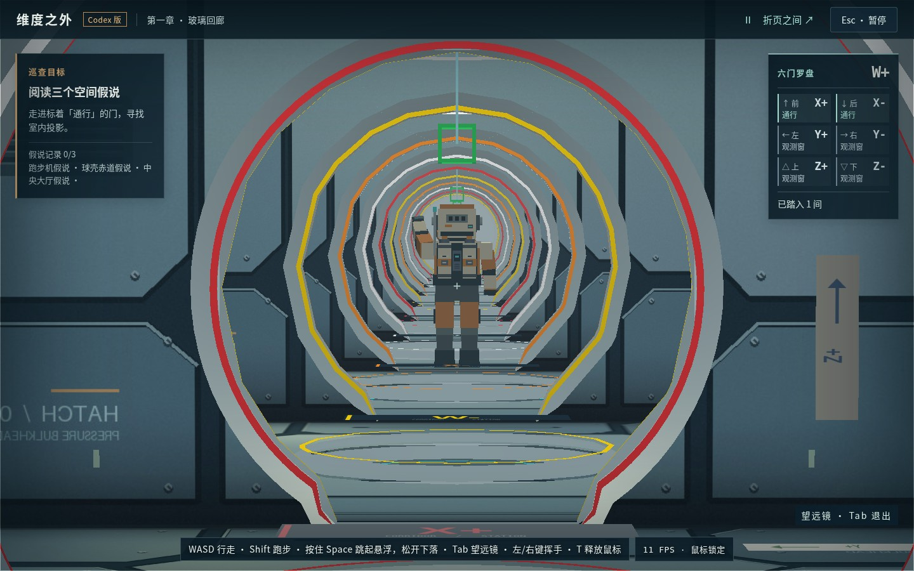
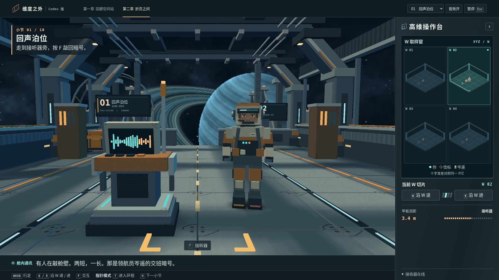

# 《维度之外》Codex 版游戏评估报告

**综合评分　7.9 / 10　　适合开放试玩，优先验证新手推理。**

隔着四扇舱门，你抬起左手，远处的“另一个人”也抬手。这个瞬间比解释八胞体更适合作为《维度之外》的名片。玩家能用自己的身体提出一个问题，再用下一次动作寻找答案。第二章也有同样的时刻：玩家双脚站定，切换 W，刚才空着的泊位里出现了岑遥。

两章已经建立了可操作、可验证的空间规则。当前最影响体验的两处设计，一处让玩家在明白规则后继续重复，另一处又在玩家形成猜想前给出走法。**保留能让人自己发现规律的时刻，比立即增加第三章的关卡数量更重要。**

## 评分依据

| 评估维度 | 权重 | 分数 / 10 | 主要依据 |
|---|---:|---:|---|
| 空间探索与玩法辨识度 | 20% | 8.5 | 挥手自证、原地换页、跨维推箱都能亲手复验 |
| 四维几何与科学表达 | 18% | 9.0 | 门的邻接、坐标运输、两种四维实体的截面能相互核对 |
| 关卡节奏与推理自由 | 15% | 6.5 | 首章登记重复，信匣和货栈的首次提示给得过深 |
| 剧本与同伴塑造 | 12% | 7.5 | 敲击暗号有首尾回收，岑遥中段常承担报操作步骤的任务 |
| 美术、光影与场景辨认 | 10% | 8.0 | 雕像、舱门、自像各有辨认价值，部分工作位轮廓接近 |
| 操控、导航与易读性 | 10% | 7.5 | 罗盘、地图和指针切换实测可用，多项信息需同时读取 |
| 性能与设备适配 | 8% | 6.5 | 已有自适应画质和帧时间记录，显卡 60 FPS 仍待复测 |
| 工程与回归可信度 | 7% | 9.0 | 52 套自动测试及两章真实浏览器通关可复查 |

**评估口径**　目标玩家为具有普通本科知识、未学过四维几何的桌面玩家。评分为设计评审判断，按权重汇总后保留一位小数。依据为发布版代码、已归档实机截图和验收记录。本次复核未新增受试者。下文含两章谜底。

评估版本为 2026 年 11 月 21 日已发布的独立分支提交 `c3f2051`。[版本快照](https://github.com/zhang-guangfei/4d-space/tree/c3f2051c9f5de4c2c6fe62a9799d064a62a2bb85) · [第一章试玩](https://zhang-guangfei.github.io/4d-space/codex/) · [第二章试玩](https://zhang-guangfei.github.io/4d-space/codex/chapter2/)

---

# 第一章《回廊空间站》

## “那个人是我”值得让玩家自己发现

上篇最好的安排，是让玻璃、舱门和可挥动的左右手共同作证。只看到背影，玩家可以猜是另一名站员。换手再挥，猜想就多了一次检验。维纳斯和大卫也有同样的作用：看得到脸和转肩的雕像，比一串房号更容易充当转向参照。建议保留第一次观察时的安静，让玩家有时间回头、挥手、再向门里看。

**实机画面**　望远镜中的背影保留了头盔通风栅、双氧瓶和左右腕带。舱门的层层开口同时给出距离线索。[雕像近景](../screenshots/codex/venus-front.jpg) · [另一侧的大卫](../screenshots/codex/david-front.jpg)

## 地图解决了认路，前置门槛仍消耗节奏

下篇六门罗盘随视线转动，回答“下一胞在哪扇门后”；下方展开图保持朝向，回答“我在整条路的哪里”。两者配合得当。提示可开关，金线从已走前缀续算。实机从 W+ 出发沿七段提示走完八胞，返回镜面球。已有通关证据足以确认这套提示能带人走通。[第四胞时的地图](../screenshots/codex/route-in-progress.jpg) · [完整实机路线](../validation/codex-route-journey.json)

更重的负担在挑战之前。八胞各须登记三次，W+ 初始计一次，共需凑满 24 份记录。规则按深入舱内登记，重复调查期间缺少新的判断任务。第一章刷新会重建进度，第二章已能恢复小节、货栈状态和站位。**优先给第一章增加断点恢复，再试验用一次“猜下一胞并亲自验证”替换部分重复登记。** 保留完整巡查供喜欢踏勘的玩家选择。[调查与解锁规则](../../apps/fps-demo/dist/chapter-progress.js) · [第一章进度入口](../../apps/fps-demo/dist/chapter.js)

---

# 第二章《折页之间》

## 岑遥的声音给第四维一个具体用途

“两短，一长”先让人知道舱壁后有人。玩家站在原处沿 W 移动，终于看见了她。结尾再次回到接听器，同样的暗号引来第三个人的声音，悬念有了来源和去向。第一人称现场与常驻高维操作台在货栈最有意义：岑遥只能看见眼前的车道，玩家看得到多个切片，两人拥有不同的信息，合作由此成立。

**实机画面**　同坐标的甲板、柱子和接听器提供参照。货栈的上下两层甲板用 Z 标记，操作台的四个 W 取样窗表示不同的第四坐标。[同站位 W1](../screenshots/codex/echo-same-xyz-w1.jpg) · [同站位 W2](../screenshots/codex/echo-same-xyz-w2.jpg)

## 十小节里，最值得保留的学习顺序

| 小节 | 给玩家的新判断 | 评估 |
|---|---|---|
| 1–3　泊位、信匣、天桥 | 沿 W 改变可达性，再判断看似相接的桥能否承载人 | 入门由浅入深。信匣目标提前写出了去 W2、绕墙、回 W1 的整套操作 |
| 4–5　潮汐球、八面体雪线 | 在相同中心尺度下，预测哪种截面缩得更快 | 全章最强的科学体验。把两次观察并列，玩家可以靠目测验证 |
| 6　四维货栈 | 切换 XYZ / XYW 后，哪里能站到箱子背后 | 最有重玩潜力。首句对白已经点出 W4 和上甲板绕行，减少了规划机会 |
| 7–10　钥匙、锚环、检修、回执 | 用翻转和绕行解决配合、脱扣与返航问题 | 动作重新服务于人物。检修对象是航服夹层中的返航签，尾声回收暗号 |

改写对白时，可让岑遥先报告驾驶席能感知的现象，例如“我能顶到箱子，但从这边看不到它背后”。玩家主动求助后，再给绕行方向。这样既保留角色声音，也把决定航线的权力交回玩家。[小节目标与对白](../../apps/fps-demo/dist/chapter2/rules.mjs) · [货栈实机画面](../screenshots/codex/cargo.jpg)

---

# 科学表达与实机性能

## 哪些现象经得起复验

第一章行走在八胞体的三维边界上。每胞有六个相邻胞，同轴、反号的两胞之间至少需过两扇门。门后自像依赖受限在边界上的光路和可见门孔。第二章引入了另一种能力：沿独立坐标 W 移动，实机往返时相机 XYZ 都为 (0, 1.68, −6)。右台选取四个 W 值，甲板和立柱的厚度仍在各自的三维空间内。[边界拓扑](../../apps/fps-demo/dist/chapter-topology.js) · [W 轴坐标记录](../validation/codex-w-axis.json)

《潮汐球》与《八面体雪线》给出了一组很好的对照。沿 W 偏离中心距离 d，半径 R 的四维实心球截出半径 √(R²−d²) 的三维球体；按当前坐标轴切开四维正十六胞体，八面体的轴向半径为 R−|d|（两式均取 |d| ≤ R）。两者中心尺度都是 1.5，相隔一格后分别约为 **1.12 和 0.50**。这是可以在游戏里先打赌、再观察的量。密封墙绕行则依赖墙在 W 方向的有限延伸，四维能力也有明确条件。[截面计算与货栈规则](../../apps/fps-demo/dist/chapter2/puzzles.mjs) · [潮汐球高清画面](../screenshots/codex/sphere-w2-hd.jpg)

## 帧率必须和绘制尺寸一起读

下表来自发布版本的独占 Chromium WebGL 记录。窗口为 1280×720，机器有四核 CPU 配额，使用软件渲染。P95 帧间隔越大，转身和穿门时越容易感觉顿挫。

| 场景与动作 | 后端 | 内部绘制 | 实际 FPS | P95 帧间隔 |
|---|---|---:|---:|---:|
| 第一章持续前进、穿门 | SwiftShader | 384×216 | 36.01 | 50.4 ms |
| 第一章持续前进、穿门 | Mesa llvmpipe | 448×252 | 52.33 | 33.5 ms |
| 第二章泊位、货栈、回执，分别静止采样 | SwiftShader | 384×229 | 35.56–36.12 | 48.1–53.1 ms |

**启动与稳定性。** 第一章开始按钮在 2.56–3.10 秒就绪，点击至绘出用时 39–44 ms。第二章对应为 2.44 秒和 134 ms。第一章完整巡查与第二章十小节通关分别记录 47、52 次资源响应，两次流程均无 JS 异常、控制台错误或加载失败。四种尺寸下，第二章十小节的行进与完成状态共通过 80 组布局检查。这些记录覆盖了常用桌面流程，低视力可读性、晕动不适与长期游玩疲劳仍待真人验证。[第一章实测](../codex-route-playtest.md) · [第二章性能](../validation/codex-quality-chapter2-profile.json) · [第二章通关](../validation/codex-quality-chapter2-journey.json)

**用户实测 120 FPS** 来自前一轮画质调整前的个人电脑反馈，缺少设备、画布尺寸和场景记录。新版在显卡上以 60 FPS 为自动档目标。要判断多出的像素是否值得，需在同机、同机位、相同动作下记录帧率和 P95；独占软件渲染数据不能替代这次比较。

---

# 下一轮迭代建议

## 先解决哪三个问题

| 顺序 | 具体改动 | 如何验收 |
|---|---|---|
| 1　保护首章进度 | 在查完假说、进入下篇、挑战中途保存调查与已登记路线，并提供重新开始入口 | 分别在三处刷新，核对胞、调查数、提示状态和下一步目标，继续走到镜面球 |
| 2　把关键猜测留给玩家 | 信匣先展示完整铅封；货栈先让岑遥报告受阻。在玩家求助后，依次给现象提示、方向和完整走法 | 观察玩家第一次自发换 W、第一次换观察基的时机，以及他们能否说出理由 |
| 3　建立同机画质基准 | 先复测反馈 120 FPS 的设备，再补一台集显和一台独显；固定版本、视口、设备像素比和起始机位 | 每档预热后各采样 60 秒，测穿门、快速转身、望远镜和货栈。记录缓冲尺寸、FPS、帧间隔 P95 及明显卡顿 |

第一章的登记数量建议用两版对照。保留现有 24 份登记作为一版，另一版让玩家走遍八胞后完成两次预判。比较两组的首次正确预判、查看提示的时点和主动中止的位置。即使新版通关更快，也要核对玩家还能否预测一扇尚未走过的门。

## 给下一次试玩的三个提问

招募 **6 位未学过四维几何的本科生**做小规模形成性测试，记录有声思考或经同意的操作录像。先让他们自由玩，避免开场讲授概念。下列判据是建议的下一轮目标，尚无受试数据。

1. **回廊**　看见门后的人时，你能做什么判断他是谁？记录是否自发挥手，以及多久形成第一次可验证的猜想。
2. **折页**　脚下位置相同时，为什么有人能在刚才空着的地方出现？请玩家在按 E 之前预测一次，并在另一个泊位复验。
3. **货栈**　换观察基后，箱子去了哪里？让玩家指出同一个箱子，再找一个可以站到箱后的位置。分开记录独立解出、请求局部线索、查看完整路线三种情况。

**进入第三章大规模制作的建议条件**　先看到至少 4/6 位玩家在无操作步骤提示时，能预测一项尚未尝试的空间变化，并用动作验证。这个门槛用于决定是否值得扩大测试。六人的结果不足以估计全体玩家的理解率。若多数人卡在同一步，先调整那一处证据、对白或操控，再扩大样本。

**评估结论**　《维度之外》值得继续做。下一次最有价值的试玩记录，是有人在按键前说出“我猜她还在那里”，然后亲手证明自己猜对了。[独立版本评审与长期路线图](../codex-review-and-roadmap.md) · [回归与验收说明](../codex-playtest.md)
